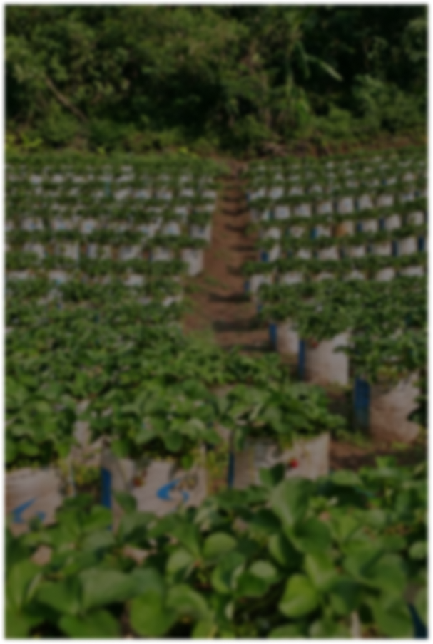
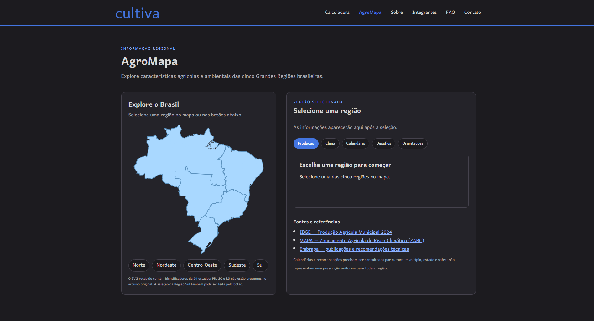
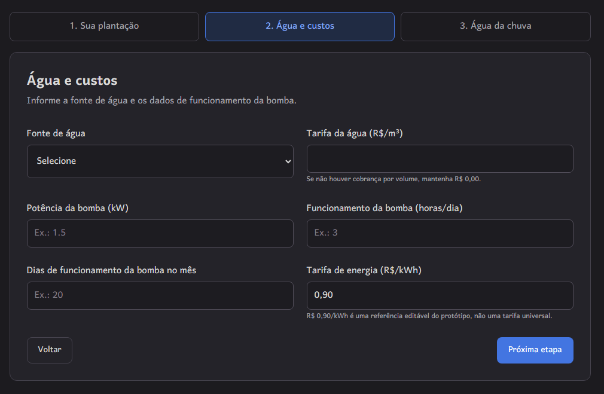
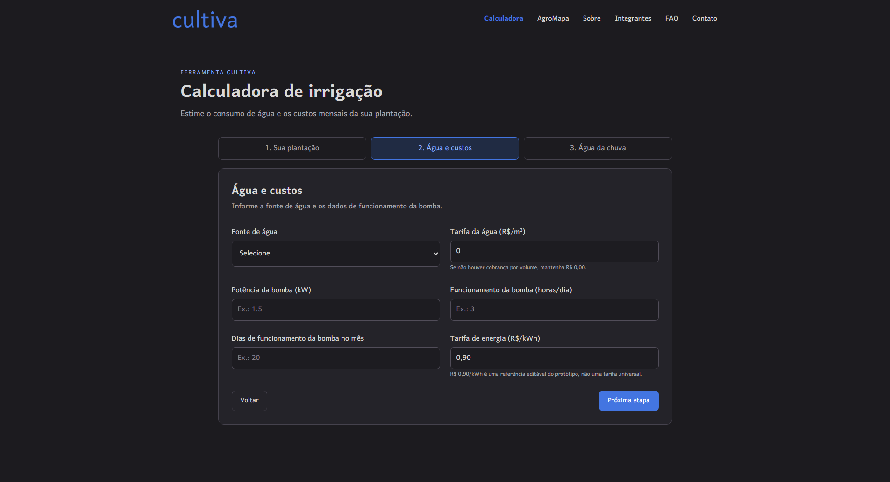
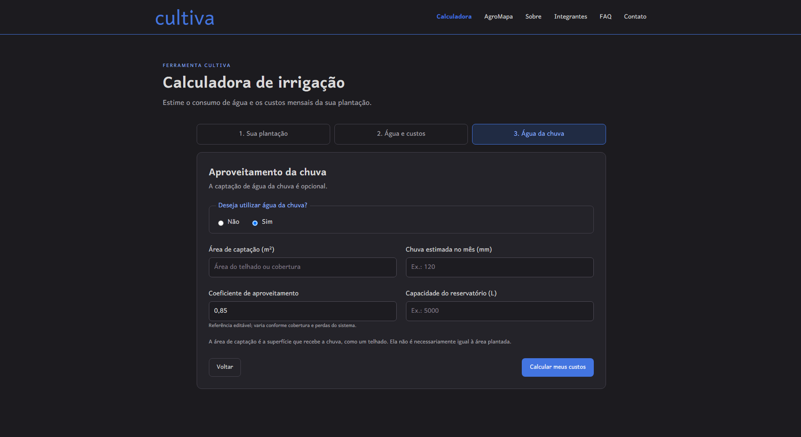
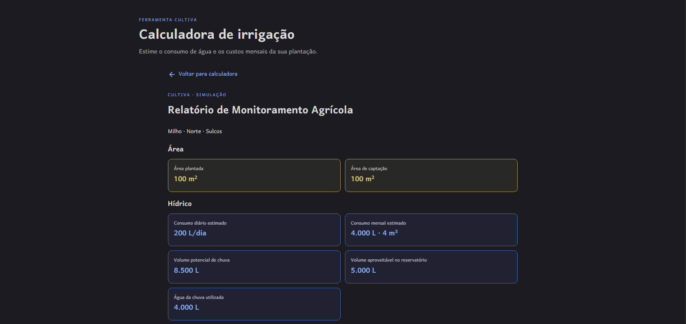
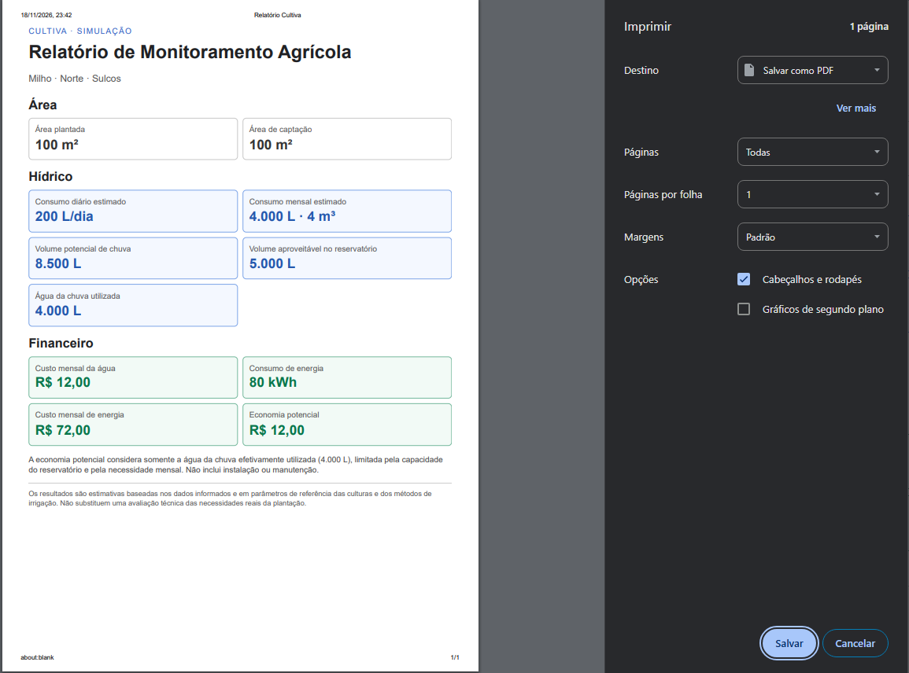

# Cultiva — Tecnologia e informação para o campo

Projeto acadêmico da Global Solution 2026/2 (FIAP), tema **CitizenTech**. O Cultiva propõe uma plataforma digital de apoio ao pequeno produtor rural, reunindo estimativas de irrigação e conteúdos agrícolas organizados por região.

## Problema e proposta

Pequenos produtores precisam decidir como manejar a água e controlar custos de irrigação em contextos diferentes de cultura, clima e disponibilidade hídrica. O Cultiva reúne uma calculadora educativa de consumo/custos e um Agromapa com conteúdos regionais para apoiar a consulta e o planejamento.

## Referência institucional

[Global Solution 2026 — CitizenTech (FIAP)](https://experience.fiap.com.br/global-solution-citizen-tech#m-cenario)



## Funcionalidades

- Home com acesso às áreas da plataforma.
- Calculadora em três etapas: dados da plantação, água e custos, e captação opcional de chuva.
- Relatório com consumo diário/mensal, custo de água, consumo/custo de energia, volume potencial de chuva, volume aproveitado e economia potencial.
- Exportação do relatório pela impressão nativa do navegador; na janela aberta, selecione “Salvar como PDF”.
- Agromapa interativo com as categorias Produção, Clima, Calendário, Desafios e Orientações.
- FAQ, contato com validação de formulário, Sobre e Integrantes.
- Navegação mobile por menu hambúrguer.

## Tecnologias

- HTML5 semântico
- CSS3 e Media Queries
- JavaScript puro
- Google Fonts — Harmattan
- Material Symbols Rounded
- API nativa de impressão do navegador (exportação para PDF)
- Git / GitHub

## Como executar

1. Extraia a pasta do projeto.
2. Abra a pasta `Cultiva` no Visual Studio Code.
3. Inicie um servidor local, por exemplo com a extensão **Live Server**.
4. Abra `index.html` pelo endereço local disponibilizado pelo servidor.

> O Agromapa carrega o SVG com `fetch`; por isso, não abra as páginas diretamente por `file://`. Use um servidor local.

## Estrutura

```text
Cultiva/
├── index.html
├── calculadora.html
├── agromapa.html
├── sobre.html
├── integrantes.html
├── faq.html
├── contato.html
├── README.md
├── css/
│   ├── style.css
│   └── responsividade.css
├── js/
│   ├── main.js
│   ├── faq.js
│   ├── calculadora.js
│   ├── agromapa.js
│   ├── agromapa-dados.js
│   └── contato.js
├── assets/
│   ├── img/
        ├── integrantes/
│   └── mapa/brasil.svg

```

## Equipe — 1TDSPA

| Integrante | RM | GitHub | LinkedIn |
|---|---:|---|---|
| Gabriely Santos Moreira | 575069 | [gabrielymoreira](https://github.com/gabrielymoreira) | [LinkedIn](https://www.linkedin.com/in/gabrielymoreira-tech/) |
| Larissa Avelina Cerqueira | 575043 | [lariavelina](https://github.com/lariavelina) | [LinkedIn](https://www.linkedin.com/in/larissa-cerqueira-330863344/) |
| Isabelly Viana Chavier Bustamante Sa | 575985 | [isabellyvianachavier](https://github.com/isabellyvianachavier) | [LinkedIn](https://www.linkedin.com/in/isabellyvianachavierbustamantesa/) |
| Stéfany Maria Santana Freitas | 576189 | [freitasfany](https://github.com/freitasfany) | [LinkedIn](https://www.linkedin.com/in/stefanymsfreitas/) |
| Renan Hesz Filho | 576071 | [renanhesz1](https://github.com/renanhesz1) | [LinkedIn](https://www.linkedin.com/in/renan-hesz-filho-3001bb431/) |

## Dados e parâmetros — Agromapa

- **Produção:** IBGE, Produção Agrícola Municipal (PAM) 2024 — destaque no valor da produção por Grandes Regiões. Os cinco produtos exibidos por região seguem o quadro da publicação.
- **Clima:** textos regionais qualitativos de contexto; não representam todas as localidades de cada região.
- **Calendário:** não foram fixados meses universais de plantio e colheita. A consulta deve ser feita no ZARC para município, cultura e safra específicos.
- **Desafios e orientações:** conteúdo introdutório e educativo; não substitui assistência técnica.

Fontes:
- [IBGE — PAM 2024 (destaques por Grandes Regiões)](https://agenciadenoticias.ibge.gov.br/media/com_mediaibge/arquivos/86bd2f37f9fffb7f3941e1c74351f469.pdf)
- [MAPA — Zoneamento Agrícola de Risco Climático (ZARC)](https://www.gov.br/agricultura/pt-br/assuntos/riscos-seguro/risco-agropecuario/zoneamento-agricola)
- [Embrapa — Portal de publicações e recomendações técnicas](https://www.embrapa.br/)

## Parâmetros técnicos — Calculadora

### Necessidade hídrica da cultura

A necessidade hídrica deve ser tratada como evapotranspiração da cultura (ETc), normalmente expressa em mm/dia. A Embrapa descreve a relação `ETc = Kc × ETo`; por isso, a ETc varia conforme cultura, fase de desenvolvimento e condições meteorológicas. O formulário solicita que o usuário informe uma referência compatível com sua situação em vez de apresentar um valor fixo universal sem base local.

Fonte: [Embrapa — Manejo da irrigação do milho e evapotranspiração da cultura](https://www.embrapa.br/en/web/agencia-de-informacao-tecnologica/cultivos/milho/producao/irrigacao/manejo).

### Eficiência de irrigação

Os valores carregados pelo seletor são pontos centrais editáveis dentro de faixas de referência publicadas pela Embrapa Hortaliças:

| Método | Faixa de referência | Valor inicial editável |
|---|---:|---:|
| Sulcos | 30%–70% | 50% |
| Aspersão convencional | 60%–75% | 67,5% |
| Pivô central | 75%–90% | 82,5% |
| Gotejamento | 80%–90% | 85% |
| Microaspersão | 80%–90% | 85% |

A eficiência real depende do dimensionamento, manutenção e condições de operação; o usuário pode ajustar o valor.

Fonte: [Embrapa Hortaliças — Irrigação](https://www.embrapa.br/web/hortalicas/berinjela/irrigacao).

### Captação de água da chuva

O coeficiente inicial de 0,85 é editável e deve ser ajustado ao material da cobertura e às perdas do sistema. O Guia Orientativo das Normas de Conservação de Água descreve coeficientes de escoamento de 0,80 a 0,95 para coberturas e recomenda fator de captação 0,85 na ausência de dados do sistema. A fórmula simplificada do projeto usa um único coeficiente agregado, conforme a especificação da equipe.

Fonte: [CBIC — Guia Orientativo das Normas de Conservação de Água](https://cbic.org.br/cbic/wp-content/uploads/sites/22/2019/11/Guia_Orientativo_Normas_de_Conservacao_de_Agua.pdf).


## Observações e limitações

- O AgroMapa apresenta informações no nível das cinco Grandes Regiões do Brasil, conforme a organização dos dados disponíveis no SVG.
- O calendário agrícola deve ser consultado para município, cultura e safra específicos no ZARC; não há meses universais de plantio e colheita.
- A ETc depende da fase da cultura e das condições meteorológicas locais. Por isso, o campo permanece editável e deve receber um parâmetro técnico adequado à situação do produtor.

## Demonstração das Telas

| Agromapa | Calculadora de Irrigação |
|:---:|:---:|
| AgroMapa Inicial | Calculadora - Etapa 1 |
|  |  |
| Calculadora - Etapa 2 | Calculadora - Etapa 3 |
|  |  |
| Relatório | Relatório |
|  |  |
| Salvar Relatório em PDF |
| 


## Contato

E-mail: [gabrielymoreira.tech@gmail.com](mailto:gabrielymoreira.tech@gmail.com)

## Repositório

**[Cultiva](https://github.com/Inova-Tech-FIAP/cultiva/)**

## Declaração de uso de IA

Ferramenta de IA generativa utilizada como apoio ao desenvolvimento: organização inicial da estrutura, revisão de requisitos, auxílio na escrita de código, identificação de possíveis erros e elaboração de documentação. Todo o código e conteúdo devem ser revisados, testados e compreendidos pelos integrantes antes da entrega.


### Imagens da página inicial
- `assets/img/img-01-index.png` a `assets/img/img-05-index.png`: imagens utilizadas nas seções visuais da página inicial.

### Organização e comentários do código
Os arquivos HTML estão organizados em cabeçalho, conteúdo principal, rodapé e scripts. Os arquivos CSS possuem comentários por grupos de componentes e responsividade. Os arquivos JavaScript incluem comentários sobre inicialização, elementos manipulados, validações, cálculos e interações.
